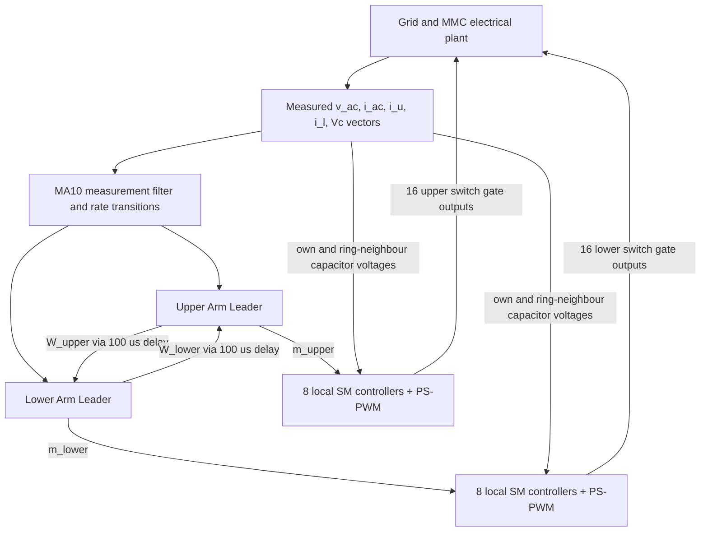

# Architecture and signal flow

## Block-level map



Each of the two Arm Leaders contains an `Outer Loop` and an `Inner Loop and Energy Balancing` MATLAB Function. There are 16 distinct Local Ctrl blocks and 16 Neighbors blocks, one pair per SM.

## Outer Loop: `mmc_outer_ctrl`

- Two identical controller instances, one per arm; both use the same grid measurements to form the AC-current reference locally.
- SOGI extraction for orthogonal voltage/current components, then normalized SOGI-PLL (`USE_PLL=true`).
- Calculates mean active/reactive power (200-sample = 20 ms moving average at 100 µs).
- PI-based P/Q regulation plus power feed-forward; a 150 ms zero-reference startup period, then a 10 kW/s reference ramp.
- Output: `i_ac_ref`, `theta`, `V_amp`, `P_meas`, `Q_meas`.

## Arm controller: `mmc_arm_ctrl`

- Computes raw arm energy as `W_arm = 0.5*C*sum(Vc_arm.^2)`.
- A 20 ms moving average is applied to its own and the other arm's energy.
- Total energy error regulates the DC circulating-current component.
- Energy difference introduces a fundamental-frequency circulating-current component.
- Forms `i_ref = s*0.5*i_ac_ref + i_circ_ref`, with `s=+1` (upper), `s=-1` (lower).
- PI/resonant arm-current controller includes 50 Hz and enabled 100 Hz compensation (`USE_CCSC=true`).
- Arm voltage reference: `v_arm_ref = Vdc/2 - s*v_ac - v_pi`.
- `m_arm = clamp(v_arm_ref/V_stack, 0, 1)` with `V_stack=max(sum(Vc_arm),0.5*N*Vc_nom)`.
- Outputs: `m_arm`, `W_arm`, `dbg`.

### Inter-arm information

The Unit Delay blocks `Comm delay W_low to upper` and `Comm delay W_up to lower` use `SampleTime=Ts_ctrl` (100 µs) and `InitialCondition=W_nom`. The design models exchange of a scalar stored-energy measurement, **not** the full capacitor-voltage vector between arm leaders.

## Local switching: `get_neighbors` + `hb_sm_local_ctrl`

For local module `i`, ring neighbours are `i−1`, `i+1` with wrap-around from SM1 to SM8. The simulated neighbour layer selects those three voltages from `Vc_arm`:

```text
err    = 0.5*(Vc_prev + Vc_next) - Vc_i
err    = 0                      when |err| < 0.1 V
m_i    = clamp(m_arm + 0.2*err*tanh(i_arm/1 A), 0, 1)
tau    = mod(t*1250 + (sm_id-1)/8, 1)
carrier = 1 - abs(2*tau-1)
S_top  = (m_i >= carrier)
S_bot  = 1 - S_top
```

The nominal per-SM triangular carrier frequency is 1250 Hz with 1/8-period carrier phase shifts. Model comments refer to 10 kHz effective interleaving (`8 × 1250 Hz`).

### Important emulation boundary

Although each **local controller** sees only its own and adjacent capacitor voltages, each **Neighbors** block currently receives `Vc_arm`, the complete simulated vector. This is a **functional abstraction** of peer-to-peer neighbour information, not proof of a real communication bus, bandwidth limit, dropouts, scheduling, or measured message delay.

## Timing and baseline model

- Solver: `FixedStepDiscrete`, stop time 1 second, fixed step `Ts=1e-5`.
- Specialized Power Systems `powergui`: discrete (`Ts`).
- Measurement MA10 at 10 µs, followed by `RateTransition` blocks to 100 µs arm control.
- `m_arm` command is rate transitioned back to 10 µs local switching.
- Baseline: `VDC=800`, `N=8`, `C=2.2e-3`, `vo=100`, `Larm=5e-3`, `Rarm=0.5`, `f=50`, `Vg_rms=230`, `Lg=2e-3`, `Rg=0.1`, `Pstar=1500`, `Qstar=0`, `fsw=1250`, `Ts=1e-5`, `Ts_ctrl=1e-4`, `Cf=10e-6`, `Rf=10`.

**Reproducibility warning:** several functions contain hard-coded `N`, `Ts`, `C`, `fsw` and gains. Keep scripts and MATLAB Function blocks consistent when changing design parameters.
